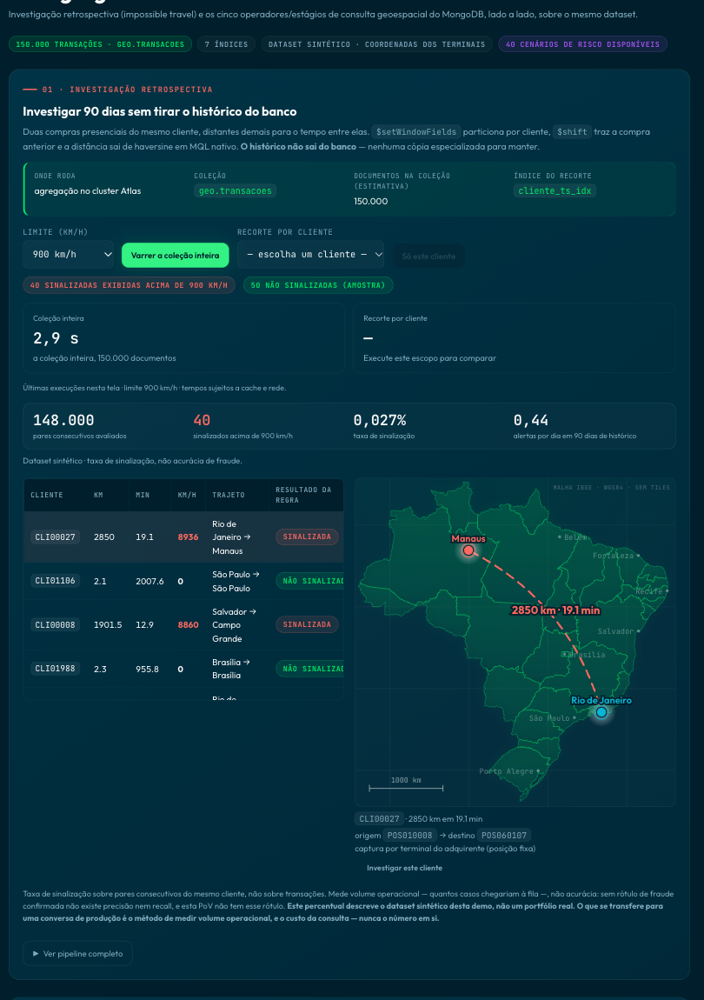
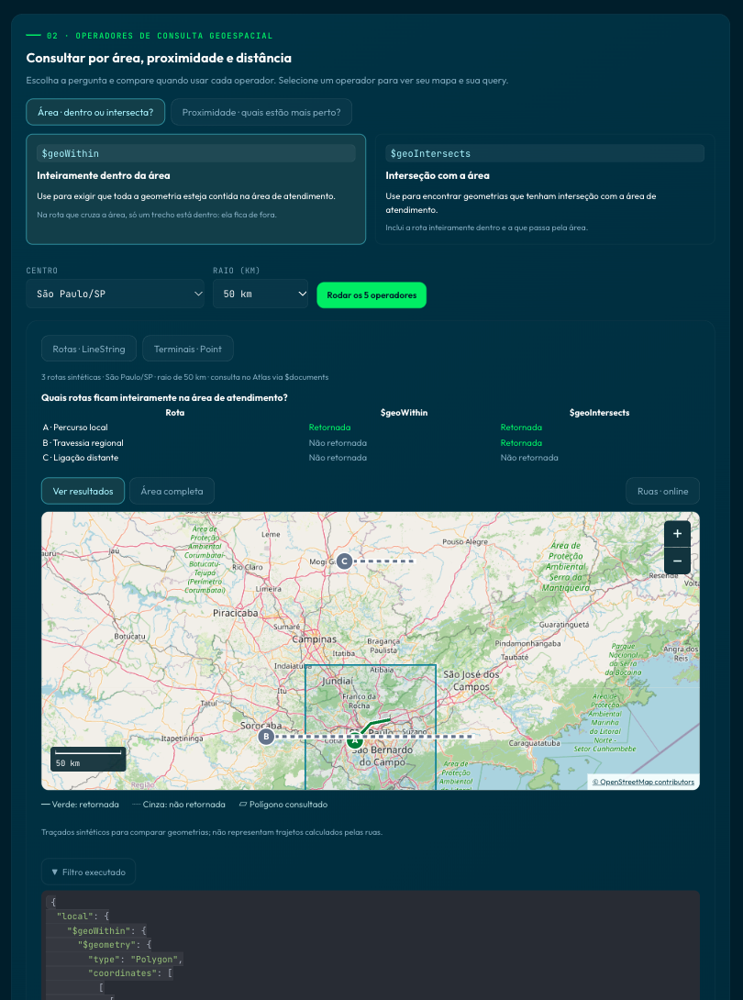
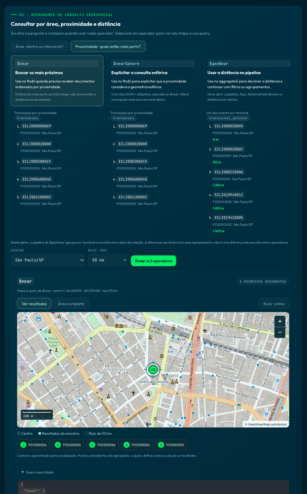
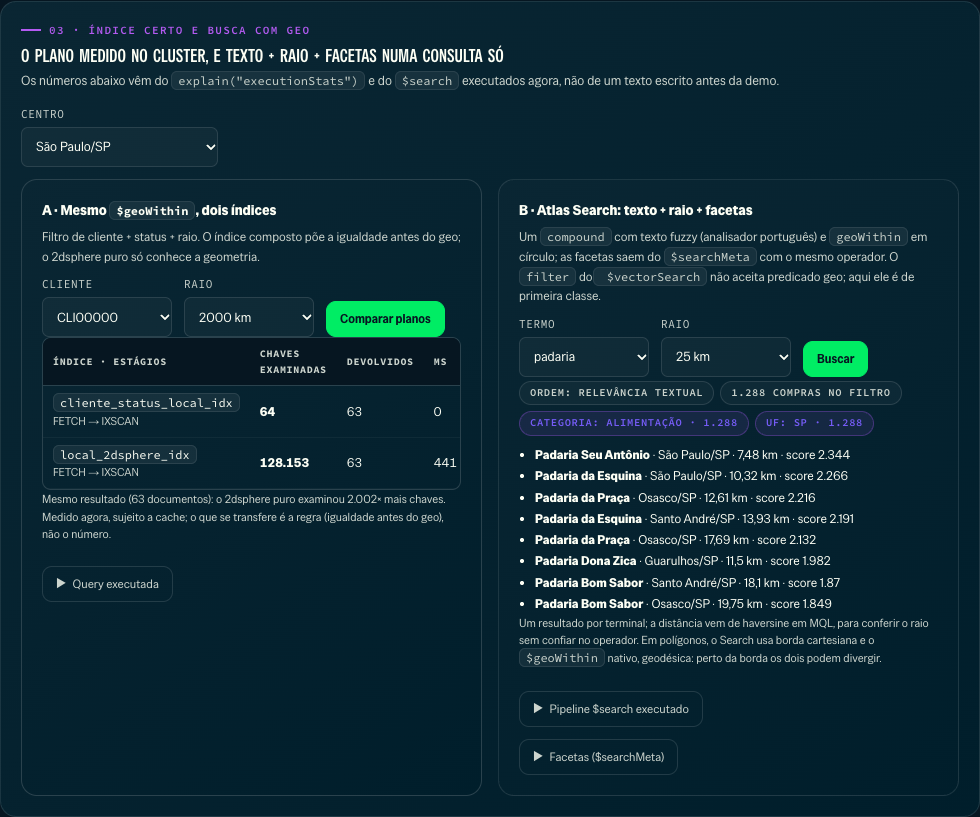

# MongoDB Atlas geo showcase

Mapa do código: [docs/MAPA_DO_CODIGO.md](docs/MAPA_DO_CODIGO.md)

An interactive PoV that proves real geospatial behavior in MongoDB Atlas against a real cluster, with no fraud-detection storytelling and no map for its own sake. Three panels:

1. **Retrospective investigation** (`impossible-travel`): pairs of card-present purchases by the same customer that are too far apart for the time between them. `$setWindowFields` partitions by customer, `$shift` brings in the previous purchase, and the distance comes from a haversine computed in plain MQL operators, inside the cluster.
2. **Geospatial query operators** (`operadores`): MongoDB's five geospatial operators/stages side by side over the same geometry: `$geoWithin`, `$geoIntersects`, `$near`, `$nearSphere`, and `$geoNear`.
3. **Right index, and search with geo** (`explain-compare`, `search`): the same `$geoWithin` measured under two indexes with `explain("executionStats")`, and one Atlas Search `compound` combining fuzzy text, `near` proximity scoring, a `geoWithin` radius, and facets.

This repository was extracted from the geo module (08) of [`mongodb-atlas-feature-showcase`](https://github.com/adrianofratelli-glitch/mongodb-atlas-feature-showcase) as a standalone PoV. React 19 + Vite frontend, FastAPI + PyMongo backend, MongoDB Atlas as the data layer. No LLM.

UI text, docstrings, and error messages are in Brazilian Portuguese by design (Brazilian audience); this README and the code structure are in English.

## What you see

**1. Investigate 90 days without taking the history out of the database.** One aggregation over 150,000 synthetic transactions scans the whole collection, flags consecutive purchase pairs above a speed limit, and plots the selected case. Here: Rio de Janeiro → Manaus, 2,850 km in 19.1 minutes (8,936 km/h), one of 40 flagged pairs out of 148,000 evaluated.



**2. Area: within or intersects?** The same three routes and the same service area, asked two ways. `$geoWithin` requires the whole geometry inside the polygon; `$geoIntersects` also returns the route that merely crosses it. The table, the map, and the executed filter come from the same Atlas query.



**3. Proximity: which are closest?** `$near`, `$nearSphere`, and `$geoNear` over the same terminals around São Paulo. `$geoNear` runs in the aggregation pipeline and returns the distance in meters.



**4. The index, measured; and text + radius + facets in one query.** For the same 63 documents, the compound index `{clienteId, status, local}` examines 64 keys in about 1 ms, while the pure 2dsphere index examines 128,153 keys in roughly 450 ms. On the right, Atlas Search returns "padaria" within 25 km of São Paulo, tie-broken by `near`, with category and state facets. The table also shows the investigation's check against the generator: 40 of 40 planted pairs found at 900 km/h, 0 emergent.



## What this proves, and what it does not

- **Proves:** real geospatial predicates (`$geoWithin`, `$geoIntersects`, `$near`, `$nearSphere`, `$geoNear`) running on the cluster with a `2dsphere` index (confirmed on screen and in `backend/tests_live`: IXSCAN, not COLLSCAN), that putting equality before geo in a compound index cuts examined keys by orders of magnitude, and a distance calculation (haversine) done entirely in MQL, without pulling data into the application.
- **Does not prove:** it is not a fraud engine, it has no confirmed-fraud label (so no precision/recall can be computed), and it does no geometry algebra (no buffer/union/intersection/area; WGS84 only, no raster or topology). `$geoNear` must be the first stage of the pipeline; the `filter` of `$vectorSearch` rejects geospatial operators.

## Commands

```bash
# Backend
cd backend
python3 -m venv venv && source venv/bin/activate
pip install -r requirements-dev.txt
cp .env.example .env   # fill in MONGO_URI
uvicorn main:app --reload --port 8184

# Dataset (repo root, backend venv active)
# writes only to a *_test database unless ALLOW_DEMO_DB_WRITE=1 (the demo db `geo` needs it)
export ALLOW_DEMO_DB_WRITE=1
python scripts/seed_geo.py            # 150k geo-referenced transactions in geo.transacoes
python scripts/seed_geo.py --drop     # recreate from scratch
python scripts/seed_geo.py --ensure   # idempotent path
./scripts/create_search_index_geo.sh  # Atlas Search index (search panel, see docs/setup-geo.md)

# Frontend
cd frontend
npm install
cp .env.example .env
npm run dev            # :5184, proxy /api -> :8184
```

Tests and lint (repo root):

```bash
pytest                          # backend/tests, stubbed Mongo, no live cluster
ruff check backend
cd frontend && node --test tests/*.test.mjs
```

Live tests and latency, against a seeded `*_test` database (read-only; `GEO_DB` in the environment overrides `backend/.env`):

```bash
GEO_DB=geo_test python scripts/seed_geo.py                 # no ALLOW_DEMO_DB_WRITE needed for *_test
GEO_DB=geo_test ./scripts/create_search_index_geo.sh
GEO_LIVE=1 GEO_DB=geo_test python -m pytest backend/tests_live   # IXSCAN, $geoNear == circle, 40/40 planted, $search radius
GEO_DB=geo_test python scripts/bench_geo.py --runs 7       # wall p50/p95 and server time (explain)
```

Before any demo: `curl http://localhost:8184/preflight`.

## Docker

One container: nginx serves the frontend build and proxies `/api` to a single uvicorn worker with the prefix removed, as the Vite proxy does.

```bash
docker build -t atlas-geo .
docker run --env-file backend/.env -p 127.0.0.1:18184:8080 atlas-geo   # http://127.0.0.1:18184
```

Prebuilt image (published to GHCR on every push to `main` that touches the image):

```bash
docker pull ghcr.io/adrianofratelli-glitch/mongodb-atlas-geo-showcase:latest
docker run --env-file backend/.env -p 127.0.0.1:8080:8080 ghcr.io/adrianofratelli-glitch/mongodb-atlas-geo-showcase:latest
```

Same `--env-file` rule as above (`KEY=value`, no quotes); tags: `latest` and `sha-<7-char commit>`.

`docker run --env-file` does not strip quotes: a line `KEY="value"` arrives with the quotes, so write `KEY=value` in the file you pass. No `VITE_*` value is baked into the image: without `VITE_GOOGLE_MAPS_KEY` the Brazil map uses its built-in fallback, and the query map uses OpenStreetMap tiles. For UI mutations, add the page origin to `ALLOWED_ORIGINS`; keep the port bound to `127.0.0.1`, because behind nginx every request reaches the backend from loopback. Health: `GET /api/health/live`; readiness: `/api/preflight`.

## Environment

Copy `backend/.env.example` to `backend/.env`:

- `MONGO_URI`, `MONGO_DB` (default `POC`), `MONGO_TIMEOUT_MS`.
- `GEO_DB` (default `geo`), `GEO_SEARCH_INDEX` (default `idx_geo_estabelecimento`).
- `DEMO_ADMIN_TOKEN`: only needed to allow mutations from anything other than loopback (this PoV exposes no destructive mutations, but the guard is the same as in the rest of the portfolio); mirror it as `VITE_DEMO_API_TOKEN` in the frontend.
- `ALLOWED_ORIGINS` (default `http://localhost:5184,http://127.0.0.1:5184`).

## Dataset

`scripts/seed_geo.py` generates 150,000 card-present transactions, Gaussian clusters around 40 real municipalities. The location is the registered coordinate of the acquirer terminal (`TERMINAL_ADQUIRENTE`, `CADASTRAL`): a terminal keeps a stable identity, merchant, and coordinate. Impossible travel is a risk signal, never a fraud decision. Idempotent through a fixed RNG seed plus a unique index on `endToEndId`.

Planted impossible-travel pairs derive the interval from a target speed (1,100–9,000 km/h), never the other way around: drawing minutes directly gave 16,000–42,000 km/h, twenty times any real cloned-card pattern. The dataset randomizes the pair's position in the customer's sequence, so cases spread across the 90 days instead of clustering at the start.

The seed records the customer IDs whose pairs were planted in `demo_metadata` (which the API reads), and, for the demo database only, in the versioned `backend/data/fraud_seeds.json` (fallback for databases seeded before this change). Seeding a `*_test` database leaves the git tree untouched. The investigation uses that list as the generator's answer key: how many planted pairs the rule finds at the chosen limit, and how many flagged pairs were not planted. That is coverage of the generator, not fraud precision or recall.

## Measured latency

`scripts/bench_geo.py` on 2026-11-12: MongoDB 9.0.7, `geo_test` (150,000 docs), 7 warm runs, from a laptop whose round trip to the cluster is about 320 ms (`ping` p50). Wall time includes the network. Server time comes from `explain("executionStats")`.

| flow | wall p50 (ms) | wall p95 (ms) | server (ms) |
|---|---:|---:|---:|
| impossible travel, whole collection | 3,732 | 3,943 | 2,669 |
| impossible travel, one customer | 943 | 992 | 2 |
| `$geoWithin` count, 50 km | 459 | 500 | 132 |
| `$geoNear`, 50 km | 637 | 812 | 380 |
| operators panel (5 queries) | 3,082 | 3,333 | — |
| `$search` text + radius, 25 km | 1,766 | 1,970 | 367 |

Read it as: per customer, the window pipeline costs about 2 ms on the server and the rest is round trips. The full scan is the expensive investigation mode (2.7 s for 150k documents on this tier), which is why production filters by customer or period before the window. These numbers describe this cluster and network, not a sizing.

## Technical pitfalls

- **`$geoNear` with more than one 2dsphere index on the field needs `key`.** `geo.transacoes` has three on `local` on purpose (pure, the compound one used by the explain panel, and category + location). Without `key`, the server refuses ("more than one 2dsphere index"). With `key: "local"`, it runs on the main collection. Measured on 9.0.7, it matches the old single-index copy: same count, same first results, same documents examined. The `transacoes_geonear` copy was retired (see [ADR 0001](docs/adr/0001-geonear-na-colecao-principal-com-key.md)). If a server still refuses, only the `$geoNear` card degrades and shows the error.
- **Circle vs. square finding:** a circle (`$near`/`$nearSphere`/`$geoNear`, via spherical `$maxDistance`) and a square (`$geoWithin`/`$geoIntersects`, via a `$geometry` Polygon) over the same radius return different counts by design, since a circle inscribed in the square covers less area. Tested on 2M documents (2,000 km radius): 128,364 (square) vs 119,152 (circle), consistent with the geometry, not a bug.
- **`$near`/`$nearSphere` are `find()` operators:** they do not work inside an aggregation `$match`, so they have no `count_documents`. This is a real MongoDB restriction, not a limit of this demo. `$geoNear` solves it: it is the aggregation path, with a mandatory first stage.
- The square around center+radius clamps coordinates near the pole/antimeridian; without the clamp, `$geoWithin` returns `BadValue` for latitude outside `[-90,90]`.
- The investigation panel runs a `$facet` with two branches over the same `$setWindowFields` (the expensive part, computed once): `sinais` (above the limit) and `aprovados` (a `$sample` within the limit). The final list interleaves the two classes instead of sorting only by `ts`, because the approved sample tends to concentrate recent dates and pushed every flagged pair to the end of the table. Selectivity (pairs evaluated / flagged / rate / alerts per day) is counted **before** the geometric cut.
- The map (`frontend/src/components/MapaBrasil.jsx`) uses the IBGE state mesh (`frontend/src/data/brasil-uf.js`, 27 states, ~41 KB), simplified with Douglas-Peucker at 0.05° over coordinates quantized to a 0.02° grid; the quantization is what prevents gaps between neighboring states. Equirectangular projection with a `cos(-15°)` factor: without it the South comes out ~18% too wide. No Leaflet/Mapbox/tiles and no external map dependency, so the module renders and stays functional with the external network blocked. The only external request is Google Fonts in `frontend/index.html`. (The street-level maps in the operators panel use OpenStreetMap tiles and are optional.)
- **Search score ties:** generated merchant names repeat ("Padaria da Praça"), so text relevance alone ties and the order becomes arbitrary. With a term, the `compound` adds `should: near` (pivot = half the radius), so the Search engine itself breaks ties by proximity. Atlas Search geo uses Cartesian polygon edges while native `$geoWithin` is geodesic: near a polygon border, the two can disagree ([ADR 0002](docs/adr/0002-painel-03-indice-e-busca-visiveis.md)).

## Security

`MutationGuardMiddleware` blocks mutations from outside loopback unless `DEMO_ADMIN_TOKEN` matches through `hmac.compare_digest`; `ApiHardeningMiddleware` applies a body-size ceiling and `nosniff`/`DENY`/`no-referrer`/`no-store` headers. This PoV exposes no destructive endpoints (no index creation/deletion, no `collMod`); both modules are read-only over `geo.transacoes`.

Never point this at anything other than a disposable demo cluster, and keep credentials out of version control (`backend/.env` is in `.gitignore`).

## License

MIT, see [LICENSE](LICENSE).
